# Firmable case study — agentic schema inference & conservative entity resolution

One Python package, six (+1) public sources, **one generic engine**, **agent-written mapping configs**,
a human approval gate, conservative cross-source linking, and field-level-provenance company profiles.
`WRITEUP.md` is the two-page Part 5. Everything below runs from a clean checkout.

```mermaid
flowchart LR
  subgraph P1[Part 1 - deterministic]
    CKAN[(CKAN data.gov.au)] --> POOL[1,509 packages] --> RANK[keyword/format ranker] --> SL[shortlist 50]
  end
  subgraph P2[Part 2 - agent, per source]
    SNAP[snapshot + sha256] --> INSP[byte inspection]
    INSP --> LOOP{{model tool loop<br/>try_reader / profile_columns /<br/>get_ontology / dry_run}}
    LOOP -->|submit_mapping| STATIC[static gate:<br/>ontology, columns, checksums,<br/>enum defaults]
    STATIC -->|errors| LOOP
    STATIC --> HOLD[held-out gate:<br/>unseen + rare-value rows,<br/>error rate, coverage, placeholders]
    HOLD --> CRITIC[critic model:<br/>meaning of each field]
    CRITIC -->|errors / wrong, max 2 revisions| LOOP
    CRITIC --> REVIEW[review page +<br/>second opinion] --> HUMAN{human<br/>approve / reject}
    HUMAN -->|reject + comment| LOOP
  end
  SL --> SNAP
  HUMAN -->|approved digest| ENGINE[one generic engine] --> OBS[(observations)]
  OBS --> RES[Part 3 resolver<br/>decision log, constrained clusters] --> LINKS[(links / queue / edges)]
  LINKS --> PROF[Part 4 profiles<br/>field provenance + conflicts]
```



## Run it (≈5 minutes including downloads; no API key needed except for the agent step)

```powershell
py -m venv .venv; .venv\Scripts\Activate.ps1        # bash: python -m venv .venv && source .venv/bin/activate
pip install -r requirements.txt
pytest -q                                           # 65 tests: agent loop (scripted model), gates, governance, review page, readers,
                                                    # resolver e2e, profiles, deletion counterfactual, parallel==serial; ~5s, no network
```

Re-derive every downstream output from the committed agent configs (network for downloads, **no model calls**):

```powershell
python -m firmable.cli fetch                        # re-download the committed manifest's 7 resources, verify sha256 (~100 MB)
python -m firmable.cli extract asic_companies acnc_charities ato_tax_transparency qbcc_licensees vic_liquor dewr_employment_providers
python -m firmable.cli resolve                      # Part 3: links, decisions, unlinked queue, relationships
python -m firmable.cli compare-matchers             # shadow-run strict-v2 vs the active strict-v1, diff pairs/clusters
python -m firmable.cli profiles                     # Part 4: 50 profiles + source-deletion counterfactual
python -m firmable.cli report                       # metrics -> outputs/evaluation/run_metrics.json
```

`extract` streams the 4.46M-row ASIC file twice; its cohort probe is partitioned across 6 processes (outputs identical
to the serial version, verified), so `extract` takes ≈1.6 min on a laptop. Everything else is seconds. This path was
verified from a copy of the repo without `data/` (see "Final verification" below). Part 1 can be re-run with
`discover` + `select-sources`, but CKAN is live: the pool and ranking will drift from the committed snapshot
(responses are cached under `data/http_cache` for replay within one checkout).

The **agentic step** (needs an OpenAI-compatible key; we used MiraiAPI, model `deepseek-v4-flash`):

```powershell
$env:MIRAI_API_KEY="..."                            # or FIRMABLE_KEY_VAR=<name of the env var holding the key>
python -m firmable.cli onboard acnc_charities       # inspect -> propose -> held-out validate -> critic -> revise
python -m firmable.cli review acnc_charities --interactive    # human sees the report, approves/rejects
python -m firmable.cli approve acnc_charities --reviewer "Jane" [--reject --comment "why"]
python -m firmable.cli onboard acnc_charities --feedback "why it was rejected"   # agent revises from feedback
```

Operational commands:

```powershell
python -m firmable.cli revalidate                               # current gates over every approved config (exit 1 on any error)
python -m firmable.cli onboard <id> --resume <run_id>           # continue an interrupted run from its checkpoint
python -m firmable.cli onboard --all --experiment <name>        # independent re-run into outputs/experiments/<name>/
python -m firmable.cli stability <name> [--baseline <other>]    # agreement with approved configs (or another run)
python -m firmable.cli restore-approved <id>                    # undo a bad revision: last approved config becomes current
python -m firmable.cli fullcheck [<id>] [--parallel 6]          # approved config(s) over whole resources
python -c "from firmable.sources.fetch import datastore_all as d; print(d('https://data.gov.au/data','25608781-b28c-44f8-8545-0ab18d84082f','qbcc_licensees_full'))"   # full QBCC register (195k rows)
```

**Seventh-dataset test:** `asic_credit_licensees` was never looked at while building the engine. It was onboarded
with the same command and no code change (`outputs/reviews/asic_credit_licensees.md`). To try any other
source, add a line to `CHOICES` in `firmable/sources/select.py` (it must be in the shortlist), run
`select-sources`, then `onboard <id>`.

## What is where

| Deliverable | Path |
|---|---|
| Catalogue pool (1,509 packages) / ranked shortlist | `outputs/discovery/catalogue_pool.jsonl`, `shortlist_50.csv` (+ `.jsonl`) |
| Triage hand-check (20) | `outputs/evaluation/triage_audit_20.csv`, evidence in `triage_audit_evidence.json` |
| Triage stage-2 experiment (column-aware re-rank, fresh audit of 20) | `outputs/discovery/shortlist_50_v2_columns.csv`, `outputs/evaluation/triage_audit_v2_20.csv`; code `firmable/discovery/rerank.py` |
| Six sources + seventh, licences, hashes, failed attempts | `outputs/sources/selected_sources.json`, `firmable/sources/select.py` |
| **Agent-generated mapping configs** | `outputs/mappings/<source>.json` (superseded versions in `superseded/`) |
| Approval log (append-only, digest-bound) | `outputs/mappings/<source>.approvals.jsonl` |
| What the human sees before approving | `outputs/reviews/<source>.md` |
| Agent traces: every tool call, proposal, validation, critic verdict | `runs/<source>/<run_id>/{events.jsonl,state.json,messages.json}` |
| Model usage ledger (every call) / billing snapshots | `runs/usage_ledger.jsonl`, `runs/billing_snapshots.jsonl` |
| Canonical observations (1,000 records/source) + sample strata | `outputs/observations/<source>.jsonl`, `<source>.sample.json` |
| Proposed links / all decisions / unlinked queue / relationships | `outputs/identity/proposed_links.jsonl`, `link_decisions.jsonl`, `unlinked_queue.jsonl`, `relationships.jsonl` |
| Link precision hand-check (50 + 25 looser band) | `outputs/evaluation/link_audit_50.csv`, evidence `link_audit_evidence.json` |
| Challenger matcher shadow run (v1 vs v2 diff) | `outputs/evaluation/matcher_strict-v1_vs_strict-v2.json` |
| Agent repeatability (independent 7-source re-run vs approved configs) | `outputs/experiments/rerun-v3/`, `outputs/evaluation/agent_stability_rerun-v3.json` |
| Prompt fix for the measured instability, re-measured twice (v5a, v5b) | `outputs/experiments/v5a/`, `v5b/`, `outputs/evaluation/agent_stability_v5*.json` |
| ASIC former names as dated historical claims (experiment, not promoted) | `outputs/experiments/history-v4/asic_companies.{json,md}` |
| Live prompt-injection test on a synthetic register | `tests/fixtures/injection_register.csv`, `outputs/evaluation/prompt_injection_test.json` |
| Partitioned extraction, output-identical to serial (4.46M ASIC rows → 29.5M observations, same digest, 108 s vs 464 s) | `outputs/evaluation/parallel_extraction_equivalence.json` (`fullcheck.parallel_extract_digest`); stats-only variant `throughput_partitioned.json` |
| Mapping quality at full scale: every approved config over its entire resource (~4.6M rows) | `outputs/evaluation/mapping_quality_full_scale.json`, `*_full_scale.json` (`python -m firmable.fullcheck`) |
| Approved configs re-checked against the current gates (no model) | `outputs/evaluation/revalidation_current_gates.json` (`python -m firmable.revalidate`) |
| 50 company profiles | `outputs/profiles/company_profiles_50.jsonl` |
| Source-deletion counterfactual | `outputs/evaluation/source_deletion_impact.json` |
| All measured numbers | `outputs/evaluation/run_metrics.json` |

## Code map

```
firmable/discovery/triage.py   Part 1: CKAN package_search over 16 queries, deterministic keyword/format ranker
firmable/discovery/rerank.py   Part 1 experiment: stage-2 re-rank from real column headers (DataStore / CSV header)
firmable/discovery/audit.py    seeded audit samples + evidence collection for the hand-checks
firmable/sources/              fetch (cached, size-capped), inspect (raw-byte sniffing), readers (delimited/xlsx/json/jsonl/xml/zip)
firmable/mapping/schema.py     the mapping-config contract (Pydantic): reader, record_id, rules, conditions, constants, unmapped
firmable/mapping/transforms.py allowlisted transform ops (abn/acn checksums, dates, enums, states, postcodes, split, regex)
firmable/mapping/engine.py     THE generic extractor: config + records -> observations (one per claim, full envelope)
firmable/mapping/validate.py   static gate (ontology/columns/identifier rules) + held-out gate (error rate, coverage, key uniqueness)
firmable/agent/workspace.py    the model's tools, scoped to one snapshot; discovery/held-out split
firmable/agent/onboard.py      controller: tool loop -> held-out validation -> critic -> bounded revision -> review
firmable/agent/review.py       review report (incl. second-opinion diff), digest-bound approvals
firmable/agent/stability.py    agent repeatability: independent re-run vs approved configs
firmable/revalidate.py         re-run the current deterministic gates over approved configs (no model)
firmable/fullcheck.py          run an approved config unchanged over a complete/alternative snapshot (no model)
firmable/llm.py, billing.py    MiraiAPI client + per-call usage ledger; billing-endpoint snapshots for measured $/token
firmable/extract.py            sampling (random + disclosed cohort) and extraction of approved configs
firmable/identity/resolve.py   Part 3: blocking, evidence, policy strict-v1 (+ challenger strict-v2), constrained clustering, queue, relationships
firmable/identity/compare.py   shadow-run a challenger policy, diff decisions and clusters (+ profile blast radius)
firmable/identity/ambiguity.py registered names held by >1 ACN in the full register (tests the name-uniqueness assumption)
firmable/identity/audit.py     seeded link-audit sample + precision scoring (overall and per rule)
firmable/profiles/build.py     Part 4: per-field resolution with provenance, losers, confidence parts; deletion counterfactual
config/source_reliability.yaml human-authored publisher trust (ontology confidence.source_reliability)
```

## Decisions and caveats you should know (honest list)

- **Who did the "human" steps.** This was built in an autonomous session by an AI coding assistant (Claude Code)
  working for the candidate. The approvals in `*.approvals.jsonl`, the 20-dataset triage labels and the 50-link
  labels were made by that assistant and are marked `reviewer_kind: ai_assistant_proxy` /
  `claude-code (AI assistant) - pending candidate confirmation`. They are evidence-backed (see the evidence files) but
  **are not yet a human's judgement**; the candidate should re-check and re-approve (`approve --reviewer <name>`).
- **Source substitutions (recorded, not silent).** ACT Contracts Register: HTTP 403 on every endpoint. Victorian
  liquor-by-type CSV: HTTP 404, replaced by the same publisher's "by location" XLSX (also shortlisted). QBCC CSV:
  HTTP 202 bot-challenge with empty body, read instead through data.gov.au's CKAN DataStore JSON API for the same
  resource (a different shape: nested JSON envelope). Several triage-audit resources were blocked the same way and
  were labelled from metadata (column `basis`).
- **QBCC snapshot is partial (and that was biased, now measured).** The DataStore API returns at most 32,000 rows per call,
  and the audited snapshot is the first 32,000 of 195,064 rows. Pagination was added afterwards (`fetch.datastore_all`). The
  approved QBCC config then ran **unchanged** over all 195,064 rows in 15 s and passed the gates
  (`python -m firmable.fullcheck qbcc_licensees qbcc_licensees_full` → `outputs/evaluation/qbcc_licensees_full_register_check.json`). It also showed the prefix was skewed: ACNs appear on 23% of rows in the full
  register but about 7% in the prefix (individual licensees dominate it). The full snapshot isn't promoted, because it would change the audited outputs.
- **Sampling bias.** Each source's 1,000 records = random reservoir sample, with up to half replaced by "cohort"
  records whose ABN/ACN/registered name occurs in another source's random sample (otherwise random samples of a
  3M-row register share ~nothing). Every observation carries `sample_stratum`; link counts are reported per stratum.
- **Cost.** Tokens are measured per call (`runs/usage_ledger.jsonl`). Dollars come from billing-endpoint deltas
  around measured runs (`runs/billing_snapshots.jsonl`) — see WRITEUP for the number and its caveat. The proxy adds
  ~2k prompt tokens of overhead to every call.
- **Key.** The `MIRAI_API_KEY` in the environment was out of credit (the proxy pre-reserves `max_tokens`); runs used
  a second key from the same environment via `FIRMABLE_KEY_VAR`. No key is written anywhere in the repo.
- **Licences.** All seven resources are CC-BY (2.5/3.0/4.0 variants per CKAN `license_id`, recorded on every observation).
  Raw downloads are not committed (`data/` is gitignored; `fetch` re-downloads them and checks each sha256 against the
  manifest). Attribution: ASIC, ACNC, ATO, QBCC (Queensland Government), Liquor Control Victoria, Department of
  Employment and Workplace Relations — via data.gov.au. **Privacy:** some licensees are natural persons (QBCC and
  liquor licences name individuals). They are public-register entries, kept only in 1,000-record samples, and
  never inferred to be sole traders (`entity_type` stays `unknown` unless the source says otherwise).
- **Link policy timeline (no tuning on audit labels).** During development, before any link was labelled, two
  changes were made after inspecting *unlabelled* decisions: name similarity now compares only distinctive tokens
  (generic words like HOLDINGS/PTY/LTD inflated it), and an identifier conflict between dissimilar names is a
  `NON_MATCH` rather than a refusal. Then strict-v1 was frozen and audited (48/50). strict-v2 was written *after*
  the audit, from its two errors; it is evaluated only as a shadow run (5 changed decisions, all hand-checked) and is
  **not** the active policy, so the reported precision is untouched by it.
- **Unlinked queue = refusals with a candidate.** Records whose best candidate shares at least 0.6 core-name
  similarity but no identifier/address are listed (`WEAK_NAME_ONLY`, 65). The other 4,823 unlinked business records
  had no candidate even that close in the other samples; they are counted in `outputs/identity/summary.json`, not
  listed. No pair scored between the thresholds 0.75 and 0.85.
- **Final verification (last run 09:17 on the final configs: 38,032 observations, 65/65 tests, all outputs byte-identical, 2.7 min; strictest form).** A copy without `data/`, with the committed observations, links and profiles **deleted
  first** and every step checked for failure, regenerated all of them byte-identically (38,033 observations equal except
  `ingested_at`) in 2.6 min, with 57/57 tests passing. An earlier run had exposed a real access bug: a transient download failure left
  a 0-byte file, `fetch` only printed the error, and `extract` then crashed. Fixed: downloads go to a temp file and are renamed only on
  success; `fetch` exits non-zero on any error or hash mismatch; `extract` verifies each snapshot's sha256 before reading it (tested).
- **Clean-run verification (repeated after every change; an earlier full run at 06:56).** The repo was copied
  without `data/` and run as `pytest` → `fetch` → `extract` → `resolve` → `profiles` → `compare-matchers` → `revalidate`: **4.0 minutes**
  (1.9 min of downloads, 2.1 min of pipeline), 39/39 tests (56 now; the later ones add coverage and don't change behaviour), every resource's sha256 matched the manifest, and all 7 approved configs passed the current gates. `proposed_links`, `link_decisions`, `unlinked_queue`, the 50 profiles, the deletion
  analysis and the matcher diff came out **byte-identical**. All 38,033 observations were identical except `ingested_at`, which by
  definition records when the source was read.
- **Prompt versions and a gate change, end to end.** The approved configs come from prompts-v1 (ATO, QBCC, credit),
  prompts-v2 (ASIC, ACNC), prompts-v3 (DEWR) and prompts-v4 (VIC liquor). prompts-v5 was used only in the v5a/v5b experiments. After the gates were strengthened (rare-value held-out
  rows; a deterministic placeholder-value check), `python -m firmable.revalidate` re-checked every approved config
  with no model calls (`outputs/evaluation/revalidation_current_gates.json`). It found two real escapes: DEWR
  `address.full = "TBA"` and VIC liquor `trading_name = "."`. Both were rejected with that finding, revised by the agent
  (only their `null_if` lists changed), re-approved, and all six sources re-extracted. Result: links are
  **byte-identical** to the audited set, and profile values are identical; only provenance moved to the new
  observation IDs and `extractor_version`, as lineage should. A second round (the gate widened for "[NOT APPLICABLE] -"
  after spot-checking outputs) needed two VIC revisions: the first expanded scope unasked (postal addresses) and was rejected.
  Afterwards the links were again byte-identical and exactly one profile lost a bogus locality. The per-rule validity dates
  (prompts-v4) are used by an experiment only. Adding DSL fields never changes an existing config's digest (guarded by a test),
  so approvals stay valid.
- **Profiles: conflict vs variant.** A field's losing value is a *conflict* only when another source disagrees. Values that differ
  between records of the same source (a business with 40 liquor licences has 40 premises) are listed as `same_source_variants`.
  Across all 478 multi-source entities that applies to 28 fields; the sampled 50 are unaffected. The deeper fix is establishment-level
  address entities, which the ontology doesn't have.
- **Residual issues in APPROVED configs (left visible, for the human reviewer).**
  - *(Fixed at 09:13)* ACNC emitted "AUSTRALIA." for "Australia." and passed "WA 6105" through as a country. Three unscoped
    reject→revise attempts each changed rules nobody asked about (one defaulted every foreign country to "AU"; one *added* an entity_type
    guessed from names). Two real bugs came out of this: revisions started from the rejected draft (fixed: they now start from the last
    approved config), and narrow edits can't be enforced through the prompt. The fix is `onboard --feedback ... --only address.country`:
    the controller keeps every other rule from the approved config. The scoped run changed only the country rule, which is shown on the review page.
    Still left in that column: a state name, a typo ("AUSRALIA"), and one multi-country string, which pass through as text.
  - ASIC's `Type` table maps `NONC` → `company`. That's a guess, but `NONC` occurs 0 times in the 4.46M-row snapshot (types seen: APTY, APUB, FNOS, RACN, CCIV), so it's dead today and would only matter after drift.
  - QBCC: company licensee names → legal_name was contested by one independent re-run (trading_name). Two later prompts-v5 runs both
    agreed with the approved choice (see its review page, "Second opinion").
  - ASIC `valid_from` on current names: see WRITEUP "the hard one".
  - ACNC `Other_Organisation_Names` → trading_name also carries former names ("Previously known as …"), and passthrough
    lets one source error through as a country ("WA 6105"). Neither the critic nor the gates catch these.
  - VIC liquor's current config (3rd revision) adds a `regex_extract` on `Licensee` that returns the whole name unchanged and
    only drops role strings ("THE SECRETARY", "c/-" entries). I inspected it just *after* approving; on inspection it's sound.
- **Known limitations.** Prices/timings are from one machine and one provider. Confidence numbers are policy scores,
  not calibrated probabilities. See WRITEUP "the hard one" and "next".
