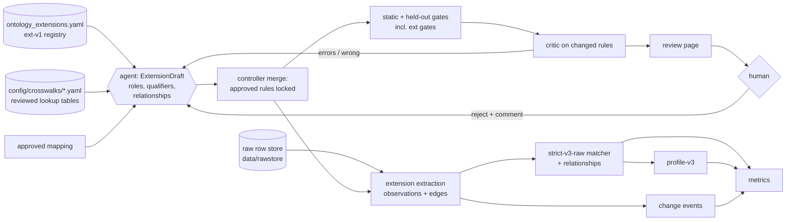

# Raw-data opportunities: what was built

This implements the review *Getting More Out of the Raw Source Files* (12 Nov 2026). The requirement
breakdown and status is in [RAW_DATA_REQUIREMENTS.md](RAW_DATA_REQUIREMENTS.md); measured results are in
`outputs/raw-data/evaluation/raw_data_metrics.json` and summarised in [Results](#results).

The case study's rules hold throughout: every value is a claim with provenance, the agent writes the configs,
a human approves them, and the audited outputs stay as they were. The extension runs as a separate pipeline
under `outputs/raw-data/`. **No extension mapping has been approved.** Every proposal is `PENDING_REVIEW`,
and every observation records `approval_state: pending_human_review`.

## Pipeline



```powershell
# agent step (needs a model key); proposals land in outputs/raw-data/mappings, pages in outputs/raw-data/reviews
$env:FIRMABLE_USAGE_LEDGER="outputs/raw-data/usage_ledger.jsonl"
python -m firmable.cli raw-onboard                       # all sources with an approved base mapping
python -m firmable.cli raw-onboard vic_liquor --reviewer "Name" --feedback "why"   # reject -> agent revises
python -m firmable.cli raw-approve vic_liquor --reviewer "Name"                    # HUMAN approval only
# deterministic replay (no model): store -> extract -> resolve -> profiles -> changes -> metrics
python -m firmable.cli raw-all
```

## Components

| Review § | Component | Where |
|---|---|---|
| 5.1 | Raw row store keyed by (source, snapshot sha256, record id). Configs replay over stored rows | `firmable/rawdata/store.py`, `data/rawstore/` (gitignored, rebuilt by `raw-store`) |
| 5.2 | Extension registry: entity, financial, licence, establishment and contact families, with types, qualifiers, crosswalk requirements and personal-data flags | `config/ontology_extensions.yaml`, `firmable/ontology.py` |
| 5.3 | One row, several entities. Configs declare `entities` (licence, establishment roles with key columns) and `relationships`. The engine emits `entity_role`, a snapshot-stable `entity_ref`, and edges | `firmable/mapping/schema.py`, `firmable/mapping/engine.py` |
| 5.4 | Crosswalks are human-reviewed tables referenced by name. The table's derivation level (L1 decode, L2 judgement) is stamped on each claim | `config/crosswalks/*.yaml`, `firmable/crosswalk.py` |
| 5.5 | Gates: decimals, period and currency on financial facts, band scheme and label, AU bounding box (with external territories), E.164 phones, email domain or role mailbox, split lists, former names posing as trading names, former-name end dates | `firmable/mapping/validate.py` (`extension_issues`, `list_issues`) |
| 1, 5.4 | Agent extension mode. The agent submits an `ExtensionDraft`. The controller locks approved rules: only role, scope and validity edits are allowed, and rules are replaced only where a current gate fails. The critic judges changed rules. Rejection with a comment sends it back | `firmable/agent/onboard.py` (`onboard_extension`), `firmable/agent/prompts.py` (`EXTENSION_SYSTEM`) |
| 5.4 | Review page per proposal: changes against the approved mapping, held-out stats including dropped values, critic verdicts, the crosswalks it relies on and their review status, remaining unmapped columns | `firmable/rawdata/review.py`, `outputs/raw-data/reviews/*.md` |
| 4.1 | Challenger matcher `strict-v3-raw`: domain, phone, geo ≤ 100 m, former name (exact, and suffix-stem), explicit holder kind. Name-only links need corroboration. Ambiguous contact points and reused former names never link | `firmable/rawdata/match.py` |
| 4.4 | Relationships: HOLDS_LICENCE, OPERATES_ESTABLISHMENT, LICENCE_AT_ESTABLISHMENT (declared by mappings), DELIVERS_PROGRAM_FOR, TRUSTEE_OF / TRUSTEE_NAMED, LICENSED_INDIVIDUAL_FOR, SAME_GROUP_CANDIDATE (review only) | `outputs/raw-data/identity/relationships.jsonl` |
| 4.2 | Profile-v3: core fields from claims about the business only, plus firmographics, establishments, licences, contact points and relationships | `firmable/rawdata/profiles.py`, `outputs/raw-data/profiles/` |
| 4.3 | Change events: snapshot diff on declared entity refs, and period comparison of financial facts | `firmable/rawdata/changes.py`, `outputs/raw-data/evaluation/change_events.jsonl` |
| 6 | Privacy: personal mailboxes are dropped in the transform; mobiles are flagged `privacy: personal` and withheld from profiles; email local parts and mobiles are masked in everything sent to the model; no profiles for individual licence holders | `transforms.py`, `workspace.mask_personal`, `profiles.py` |
| 6 | Licence title, URL and attribution string on every observation | `config/licences.yaml`, `firmable/licences.py` |
| 7 | Related dataset onboarded through the same agent: ATO 2023-24 (base mapping plus extension), for year-on-year revenue | `outputs/mappings/ato_tax_transparency_2023_24.json`, `outputs/raw-data/mappings/` |
| 8 | Measurement | `firmable/rawdata/metrics.py`, `outputs/raw-data/evaluation/raw_data_metrics.json` |

## Results

The replay extracted 92,092 observations across eight source snapshots. The base configurations
read 54 source columns, and the extension drafts read 118. The comparison counts the columns each
configuration reads in the stored sample. The snapshots contain 168 columns in total.

At a threshold of 0.85, strict-v3-raw proposed 1,455 links across 793 multi-source entities.
Compared with strict-v2 on the same observations, it kept 1,205 links, added 250 links supported by
domain and name evidence, and sent 363 previously linked pairs to review. Those 363 are exact name matches
with no corroborating evidence; 321 of them involve a Victorian liquor licensee (127 with ASIC, 194 with the
two ATO years), so Victorian linked records fall from 236 to 13 until a reviewer works the queue. All 250
added links join an ACNC charity to a DEWR provider site through a shared, non-generic email or web domain. Ten proposed links joined
two random-stratum records. The new 50-link audit is unlabelled and challenger precision is pending.

The replay produced 50 sample profiles and detected 1,990 changes, including 787 QBCC field changes
and 499 ATO total-income changes between reporting periods. The financial corruption experiment
found that none of the 18 profiles with financial facts had a second independent financial source.

Privacy: the transforms dropped 648 personal mailboxes and 283 incomplete phone numbers. No observation is
flagged personal because none of the 1,921 extracted phones (all DEWR site lines) is a mobile; the flag is
covered by unit tests.

The extension work used 7,154,131 model tokens, estimated at US$11.23 using the case study’s measured
rate. This exceeded the assignment’s US$10 target. Replaying the saved mappings uses no model calls.

All eight extension drafts still await human review. The final ACNC checkpoint re-evaluated a
recovered agent draft after later revisions lost rules. The current ACNC address scope remains
unresolved. The ASIC draft leaves deregistration date unmapped, and the Victorian draft leaves
trading hours unmapped.
