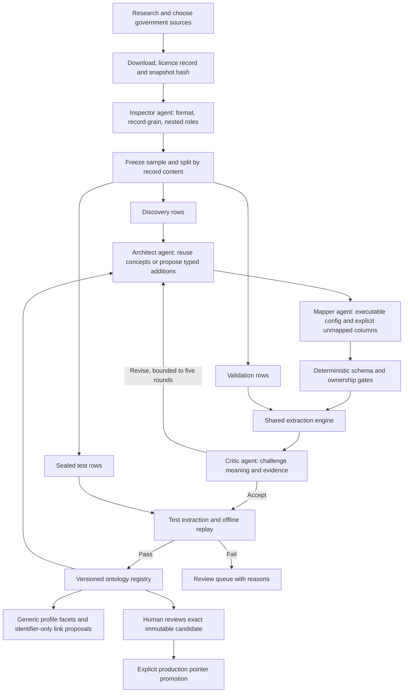

# Autonomous ontology onboarding: government-data experiment

This follow-up tests two capabilities beyond the submitted benchmark: onboarding previously unused sources and proposing new, typed ontology concepts from their actual contents. It is an experimental branch of the pipeline, not a replacement for the submitted results. Source selection was researched by the project assistant; the Inspector, Architect, Mapper and Critic execute as recorded model calls. The controller, extractor, validators and registry are deterministic software components.

## Why these three sources

| Source | Information it can add | Interpretation boundary |
| --- | --- | --- |
| [AusTender contract notices](https://github.com/austender/austender-ocds-api) — Department of Finance | Government customers, contracted goods/services, contract value and currency, dates and procurement classification | The experiment uses notices published during one day, 1–2 October 2026. A maximum contract value is neither annual expenditure nor supplier revenue. A procurement category describes the contract, not necessarily the whole supplier. |
| [Brisbane grant recipients](https://data.brisbane.qld.gov.au/explore/dataset/grants-recipients/export/) — Brisbane City Council | Funding programme, recipient, project, approved award amount and ABN where supplied | Includes community organisations and individuals. A recipient name does not prove company status; an award is not total company income. |
| [National Pollutant Inventory facilities](https://data.gov.au/data/dataset/npi) — DCCEEW | Operator identifiers, operating sites, addresses, coordinates, facility activity/classification and reporting history | This is the facilities table. It does not establish emissions quantities, environmental compliance, or current operation of every historical site. |

These sources complement basic registry identities with commercial activity, funding and operating footprint. They were chosen for utility, public access, identifiable publishers, documented licences and the possibility of identifier-based integration—not because an exhaustive ranking established them as the three best Australian datasets. The Queensland small-business-grants resource was investigated first but its download was unavailable in this environment; the accessible Brisbane export was selected instead.

The data.gov.au catalogue provides discovery and publisher links. AusTender's catalogue entry describes historical files but also points to the current OCDS API; this experiment downloads the API cohort, not a historical workbook. The licence/attribution and exact download URL, retrieval time and SHA-256 are preserved in `config/evolution_sources.json`. AusTender uses CC BY 3.0 AU; Brisbane and NPI use CC BY 4.0. Original source rows remain public-source material, including possible natural persons; they must not be represented as an exclusively corporate population.

Read [the measured results](../outputs/experiments/autonomous-ontology/RESULTS.md) for the actual acceptance outcomes. A useful dataset is not necessarily a successfully onboarded dataset; proposed concepts and rejected mappings remain visible separately from accepted observations.

The completed development run accepted all three candidates after revisions and explicit resumes: 1,293 sampled records produced 18,516 observations and 37 additive concepts. The sealed tests contained 257 records and 3,616 present mapped values, with zero type/constraint errors. Across the full samples, four invalid NPI identifier values were rejected; missing values and deliberately unmapped columns remain visible. Twelve exact-ABN link proposals connect new entity views to records in the existing sample. These are not twelve verified companies or a measured precision result. The grant mapping deliberately leaves recipient-to-company identity unresolved.

## Roles and control flow



| Component | Responsibility | What it cannot authorise |
| --- | --- | --- |
| Inspector agent | Inspect actual bytes; choose the shared reader; distinguish row grain and nested party roles | Treat a filename as sufficient evidence or silently select one of multiple matching suppliers |
| Ontology Architect agent | Reuse concepts where meaning and owner agree; otherwise propose definitions, types, qualifiers, entity types and relationships with real-column evidence | Change an existing concept's meaning or invent unobserved source columns |
| Mapper agent | Generate one declarative mapping using the shared transformation allowlist; explain unused columns | Execute arbitrary code, use source-specific parser scripts, or manufacture missing field values |
| Deterministic validator/executor | Enforce schemas, entity ownership, qualifier requirements, identifier checksums and typed extraction; count failures | Establish semantic truth merely because a value has the correct type |
| Critic agent | Inspect validation examples, challenge interpretation, and return actionable accept/revise/reject feedback | Act as a human reviewer or inspect the final sealed test partition |
| Registry/controller | Bound revisions and budget; checkpoint calls; version additive changes; preserve old versions; verify replay | Promote a candidate as human-approved without an explicit review command |
| Profile projector | Render new concepts generically with definitions, evidence and separate confidence components; propose exact-ABN links | Merge on a similar name or claim measured link precision without labelled checks |

The agents share a model in this experiment but have separate responsibilities and prompts. The Critic is a second model call, not an independent human or an independent model family. Data and metadata are explicitly treated as untrusted content rather than executable instructions.

The final Critic receives field-stratified examples, rejection counts, an explicit execution contract and a directly executed whitespace-transform probe. It distinguishes false emitted claims from absent values, rejected invalid identifiers and conservative privacy withholding. Structured blocking findings can record actual versus expected behaviour, evidence and a correction; an accepting verdict with a nonempty blocker list cannot pass. This improves review grounding but does not make the model Critic a semantic ground-truth oracle.

## How the ontology evolves

The starting registry compiles the existing core and `ext-v1` ontology. Each accepted source produces an immutable child version. Every new concept carries an owner, definition, value type, required qualifiers, observed-column evidence and an explanation of why existing concepts do not fit. New entity and relationship types are proposed through the same strict contract. Later sources receive the previously accepted candidate registry and can reuse it.

For example, an agent can propose a `contract` entity linked to its supplier and purchasing agency. The contract's value remains a claim about the contract with a currency qualifier. A facility remains a separate establishment linked to its operator. These are modelling examples; the recorded proposals and generated experiment report show exactly what the live agents actually produced.

Successful candidates feed a generic profile-facet projector, so a new field does not require a custom profile template. It preserves field definitions, provenance, qualifiers and the existing separate confidence components. This prototype does not automatically infer a corporate hierarchy, reconcile every conflicting value, or merge new data into the original 50 submitted profiles.

Production promotion is explicit and checks a sealed evidence manifest, ontology hash, mapping digest and expected current production pointer. Historical versions remain available; a previously validated version can be restored using the same explicit promotion operation and current-pointer check. This is a local filesystem registry for a single trusted operator, not a signed multi-user approval service. The production pointer belongs to this new subsystem; integration into a deployed ingestion service is future work.

## Evaluation and honest limits

Each source is parsed using the inferred reader. Up to 600 records are retained, with the first twelve preview records kept for discovery; the remaining reservoir slots sample the file. Duplicate-content records are deduplicated. Content hashes assign discovery/validation/test partitions, approximately 60/20/20 outside the forced preview. The sample is therefore slightly biased toward preview records and is not a population survey.

The agents see discovery values and the Critic sees validation values. Column names from discovery and validation are available to proposals, so a validation-discovered column can be mapped during revision. Final test rows are withheld from model revision. Their type/constraint error rate is measured once the Critic accepts; the acceptance gate is at most 5% errors among present mapped values and at least one emitted observation. This gate is **not** 95% semantic accuracy: it does not establish that every mapping is correct, and it can coexist with missing/unmapped columns and refused records. Reports show those counts separately. No new human semantic-precision estimate is claimed.

Nested singleton bindings use explicit discriminators where supplied. Multiple matches enter a refusal queue rather than losing suppliers silently. General repeated-array expansion is not implemented. Structural drift detection reports added/missing columns; it does not yet detect same-column semantic drift or trigger a scheduled autonomous re-onboarding service. A new schema should be evaluated in a new output directory, preserving the old evidence.

The meaningful autonomy claim is bounded: after a researched source is registered, model calls propose the reader, mapping and ontology changes, validation drives revisions, and deterministic code assembles a reviewable candidate. Source discovery, production approval and semantic ground-truth labelling are not autonomous in this prototype. This is a development experiment: generic controller fixes (JSON-fence parsing, observation-date coverage and repeated-array refusal) were made during the run. Mappings were not manually edited. Cached responses are retained, superseded responses are archived when feedback changes, and all reported model usage remains in the ledger. It is not an untouched, preregistered benchmark of a finished engine.

## Reproduce

From the repository root with the ordinary Python requirements installed:

```bash
# Offline: uses the committed agent responses, frozen rows and ontology versions.
python -m firmable.evolution replay
python scripts/build_evolution_report.py
python -m pytest -q tests/test_ontology_evolution.py

# Optional live experiment: requires your configured model API key and publisher access.
python scripts/evolution_sources.py
python -m firmable.evolution run --live --output outputs/experiments/my-ontology-run
```

Live calls use the existing configurable client and token ledger. The repository default is the direct DeepSeek endpoint and `DEEPSEEK_API_KEY`; this recorded experiment uses the owner's authorised Mirai gateway with `deepseek-v4-flash`. No key is stored. Failed requests are logged, but provider token usage for failed/timed-out requests may be unavailable. Live inference can take substantially longer than the original ten-minute offline submission check.

To onboard your own source, supply `--sources path/to/manifest.json` with the same metadata structure as `config/evolution_sources.json`: a local file, publisher/URL/licence, retrieval timestamp and file SHA-256. No mapping or ontology additions should be supplied. Supported formats are those of the shared readers; this is not universal document ingestion.

The normal pass permits five proposal/mapping rounds. Before sealing, an explicit `resume-source --source-id ID --live --rounds 3` continues a source from its last validation feedback for a separately logged, bounded allowance. Explicit resumes were used for all three sources while improving revision messages and execution-contract evidence. This was supervised development, not three first-pass successes or an unreported infinite retry loop. `FIRMABLE_EVOLUTION_TOKEN_BUDGET` limits the experiment ledger (default 500,000); the shared client's `FIRMABLE_TOTAL_TOKEN_BUDGET` additionally reserves space for a whole request. The development allowance increased from 500,000 to 1,500,000 and finally 2,300,000 tokens when the owner requested continuation. The ledger records 2,032,355 reported tokens; failed or cancelled request usage may be unknown. `FIRMABLE_DISABLE_THINKING=1` can request disabled reasoning on a compatible gateway; unsupported providers may reject or ignore it.

Structural drift can be checked without model calls: `python -m firmable.evolution check-drift --source-id ID --input NEW_FILE`. A repeated nested collection can deliberately refuse records; no automatic scheduler or unbounded re-ingestion daemon is included.

After completing a run, `python -m firmable.evolution seal --output PATH` verifies replay and seals evidence. Actual human approval is recorded only by an intentional `promote --output PATH --version HASH --reviewer NAME` invocation. When replacing a production version, include `--expected-current OLD_HASH`. No production promotion was requested or performed for this experiment.
